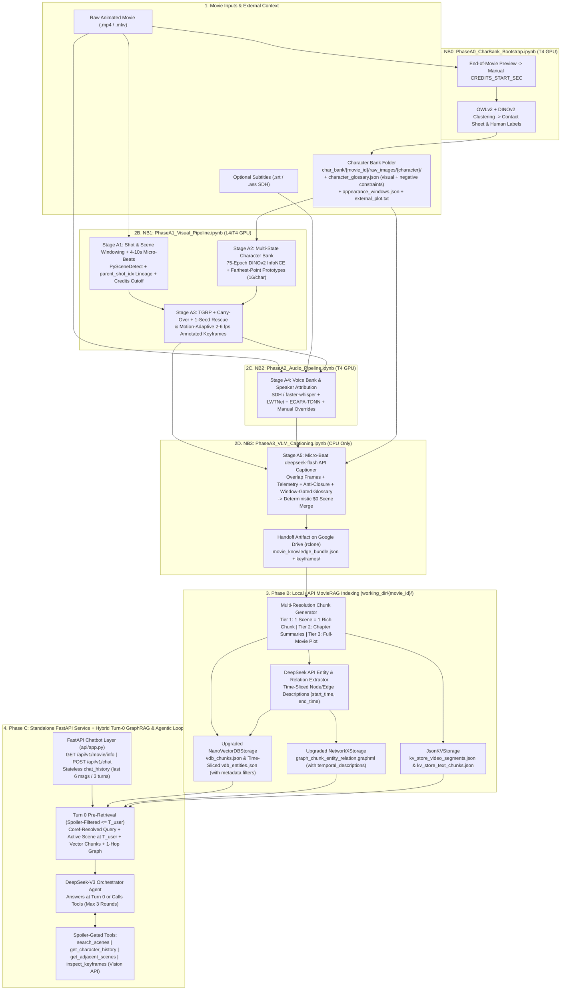

# MovieRAG: Animated Movie Multimodal Knowledge Base & Spoiler-Aware RAG

> **Master Architecture & Design Index**
> This note serves as the central hub for the end-to-end MovieRAG architecture. It connects the offline animated character recognition pipeline (`Animated_AD` + `DeepSeek-Flash` micro-beat VLM) with our spoiler-aware, multi-resolution, agentic `MovieRAG` engine.

---

## Sub-Notes Index
1. **[[01_PhaseA_Animated_AD_Pipeline]]** — Hybrid cluster + human character bank (`Stage A0`), shot-aligned scene windowing + 4–10s micro-beats + manual credits cutoff (`Stage A1`), multi-state `DINOv2` bank (`Stage A2`), sharp-seed TGRP tracking with seam carry-over + 1-seed rescue + 2–6 fps motion-adaptive annotated keyframes (`Stage A3`), hybrid speaker attribution + manual overrides (`Stage A4`), and single-pass micro-beat `deepseek-flash` VLM captioning with telemetry/anti-closure rules + `$0` deterministic scene merge (`Stage A5`).
2. **[[02_Data_Handoff_and_Storage_Schemas]]** — Exact JSON specifications for `movie_knowledge_bundle.json` (and `shots_and_scenes.json` `micro_beats`), 1-Scene = 1-Chunk `TextChunkSchema`, `NanoVectorDB` metadata fields (including time-sliced rich `entities_vdb`), and time-sliced `NetworkX` graph node/edge schemas.
3. **[[03_Spoiler_Aware_GraphRAG_and_Retrieval]]** — Dual-layer 3-tier knowledge indexing (`scene`, `chapter`, `full_movie`), time-sliced entity/relation merging, straddle-safe timestamp filtering (`T_user`), **Multi-Turn Conversation Memory (`chat_history`)**, and the **Hybrid Turn-0 GraphRAG + Bounded Agentic Tool-Calling Loop (`DeepSeek-V3` + `inspect_keyframes` Vision Sub-Tool)**.
4. **[[04_Implementation_Roadmap_and_Milestones]]** — Step-by-step file modification blueprint across `pipeline/` + `notebooks/` (Phase A — Completed), `MovieRAG/`, and `api/app.py` (Phase B & C — Next Up), plus validation milestones starting with `Sintel.mp4`.

---

## 1. Core Architectural Pillars

| Pillar | Decision Locked In | Why It Solves Previous Bottlenecks |
| :--- | :--- | :--- |
| **1. Motion-Adaptive 2–6 fps Keyframes + Micro-Beat `deepseek-flash` Captioning** | Sample sharp keyframes at **2–6 fps** (`base_fps=2.0`, `max_action_fps=6.0`, Laplacian floor `10.0`), partition each 15–30s scene into **4–10s micro-beats**, call `deepseek-flash` (`thinking: disabled`, `960px` width, `max_tokens=450`) with visual overlap (`[Context Only]`) + previous beat text + telemetry/anti-closure guards + time-gated visual-first glossary, then deterministically merge beats back into scenes (`$0`). | Eliminates sparse keyframe blind spots, Qwen repetition loops, premature fight completion, `[EXIT_STATE]` fluff, and absent-character/spoiler leakage while cutting VLM cost to ~\$0.20–\$0.30/movie. |
| **2. Per-Shot TGRP (Unbroken Take Carry-Over + 1-Seed Rescue) $\rightarrow$ Scenes & Micro-Beats** | Run `TGRP` (`OWLv2` creature/warrior prompts, `min_box_area_ratio=0.0015`, 3 sharpest seeds) per shot, reset SAM 2.1 at real hard cuts, carry over boundary boxes **strictly across `is_subdivided_continuation` seams** of $>20\text{s}$ takes, rescue 1-seed tracks (`OWLv2 >= 0.20`, `DINOv2 >= 0.55`), and group shots into 15–30s scenes + 4–10s micro-beats. | Prevents SAM 2.1 masks from breaking on cuts, keeps bounding boxes alive across 15s take subdivisions, and improves recall on distant wide/dark shots. |
| **3. 3-Tier Multi-Resolution Index (`1 Scene = 1 Chunk`)** | **Tier 1 (`scene`)**: 1 Scene = 1 rich chunk (timestamped merged micro-beat VLM breakdown + speaker-tagged subtitles, no multi-scene squeezing).<br>**Tier 2 (`chapter`)**: 5–10 min progressive summaries.<br>**Tier 3 (`full_movie`)**: Time-aligned `external_plot_documents` (`end_time = duration`, unlocked only when `spoiler_free = False`). | Preserves exhaustive visual and subtitle detail per scene while keeping `external_plot` strictly isolated in Tier 3 so early tiers never leak spoilers. |
| **4. Time-Sliced Knowledge Graph & Rich `entities_vdb`** | Store `temporal_descriptions: [{start_time, end_time, tier, description}]` on every graph node/edge AND store time-sliced rich entity embeddings in `entities_vdb` with `start_time`/`end_time` metadata. | Gives `entities_vdb` full semantic description recall while strictly blocking future character twists or unintroduced entities when `spoiler_free = True`. |
| **5. Hybrid Turn-0 GraphRAG + Agentic Tool-Calling Loop** | **Turn 0**: Auto-injects the Active Scene at `T_user` + Spoiler-Filtered Original GraphRAG output (Vector Chunks + Entity Rewrite $\rightarrow$ 1-Hop Graph Co-Occurrence Scenes + Graph Entity/Edge Histories $\le T_{\text{user}}$).<br>**Rounds 1–3**: `DeepSeek-V3` either answers immediately (0 tool calls) or invokes spoiler-gated tools (`search_scenes`, `get_character_history`, `get_adjacent_scenes`, `inspect_keyframes`). | Combines zero-hop speed for ~80% of queries with multi-hop graph/timeline investigation and on-demand Vision API keyframe inspection (`Option A`) for hard queries. |
| **6. Hybrid Compute & 4-Notebook Colab Split** | **NB0 (`PhaseA0_CharBank_Bootstrap.ipynb`)**: T4 GPU credits preview & hybrid OWLv2+DINOv2 clustering + human labeling.<br>**NB1 (`PhaseA1_Visual_Pipeline.ipynb`)**: Visual stack (`PySceneDetect`, `OWLv2`, `SAM 2.1`, `DINOv2`) $\rightarrow$ `shots_and_scenes.json`, `visual_tracks_per_frame.json`, `keyframes/`.<br>**NB2 (`PhaseA2_Audio_Pipeline.ipynb`)**: Audio stack (`faster-whisper`, `LWTNet`, `ECAPA-TDNN`) $\rightarrow$ `attributed_subtitles.json`.<br>**NB3 (`PhaseA3_VLM_Captioning.ipynb`)**: Free Colab **CPU** runtime calling `deepseek-flash` API $\rightarrow$ `movie_knowledge_bundle.json`.<br>**Phase B & C (Local CPU)**: `DeepSeek API` + local embeddings + FastAPI (`api/app.py`). | Eliminates CUDA/PyTorch dependency clashes (`SAM 2.1`/`xformers` vs audio), runs Stage A5 on a free CPU runtime with zero GPU cost, and keeps indexing/serving CPU-only. |

---

## 2. End-to-End System Architecture Diagram



---

## 3. Directory & Workspace Organization

```text
MovieRag/
├── Animated_AD/                           # Upstream + adapted CV/Audio character recognition modules
├── char_bank/{movie_id}/                  # Character reference images, glossary, windows & plot docs
│   ├── raw_images/{Character}/            # Multi-state reference crops (from NB0 or manual frames)
│   ├── character_glossary.json            # Visual-first + timeline-gated + negative-constraint glossary
│   ├── appearance_windows.json            # Manual {char: [[start_s, end_s], ...]} timeline gates
│   └── external_plot.txt                  # Phase-granular (MM:SS - MM:SS) grounding & Tier-3 synopsis
├── MovieRAG/                              # Modified VideoRAG package (Phase B — Next Up)
│   └── videorag/
│       ├── base.py                        # Extended QueryParam (with chat_history) & 1-Scene=1-Chunk TextChunkSchema
│       ├── videorag.py                    # Added insert_knowledge_bundle() & VDB metadata fields
│       ├── _llm.py                        # Added deepseek_config (with tool calling) & vision_subtool_func
│       ├── _op.py                         # Time-sliced KG merge, Turn-0 GraphRAG context & 3-round Agent Loop
│       └── _storage/
│           └── vdb_nanovectordb.py        # Added filter_lambda support to NanoVectorDBStorage.query()
├── api/                                   # Standalone Chatbot API Layer (Phase C — Next Up)
│   └── app.py                             # FastAPI service (/api/v1/movie/info, /api/v1/chat)
├── notebooks/                             # 4 environment-isolated Google Colab notebooks for Phase A
│   ├── PhaseA0_CharBank_Bootstrap.ipynb   # Stage A0 (T4 GPU): Credits preview & hybrid cluster char bank
│   ├── PhaseA1_Visual_Pipeline.ipynb      # Stages A1-A3: PySceneDetect + OWLv2 + SAM 2.1 + DINOv2 + 2-6fps frames
│   ├── PhaseA2_Audio_Pipeline.ipynb       # Stage A4: faster-whisper + LWTNet + ECAPA-TDNN + manual overrides
│   └── PhaseA3_VLM_Captioning.ipynb       # Stage A5 (CPU): Micro-beat deepseek-flash API + deterministic merge
├── pipeline/                              # Phase A orchestration modules (COMPLETED)
│   ├── stage0_bootstrap_charbank.py       # Credits preview + OWLv2/DINOv2 clustering + charbank export
│   ├── stage1_scenes.py                   # Shot detection, take lineage, 15-30s scenes & 4-10s micro-beats
│   ├── stage2_charbank.py                 # Contrastive DINOv2 tuning + Farthest-Point 16/char bank
│   ├── stage3_visual_recog.py             # Sharp-seed TGRP + seam carry-over + 1-seed rescue + 2-6fps keyframes
│   ├── stage4_subtitles.py                # SDH/faster-whisper + LWTNet + ECAPA-TDNN + manual speaker fixes
│   └── stage5_vlm_caption.py              # Micro-beat deepseek-flash captioner + telemetry + $0 scene merge
├── workdir/                               # Per-movie isolated knowledge bases (synced via rclone)
│   └── {movie_id}/
│       ├── shots_and_scenes.json
│       ├── vlm_beats.jsonl
│       ├── vlm_captions.jsonl
│       ├── movie_knowledge_bundle.json
│       ├── keyframes/                     # Motion-adaptive 2-6 fps annotated keyframes
│       ├── kv_store_video_segments.json
│       ├── kv_store_text_chunks.json
│       ├── vdb_chunks.json
│       ├── vdb_entities.json
│       └── graph_chunk_entity_relation.graphml
└── Notes/                                 # Architecture & design documentation
```
