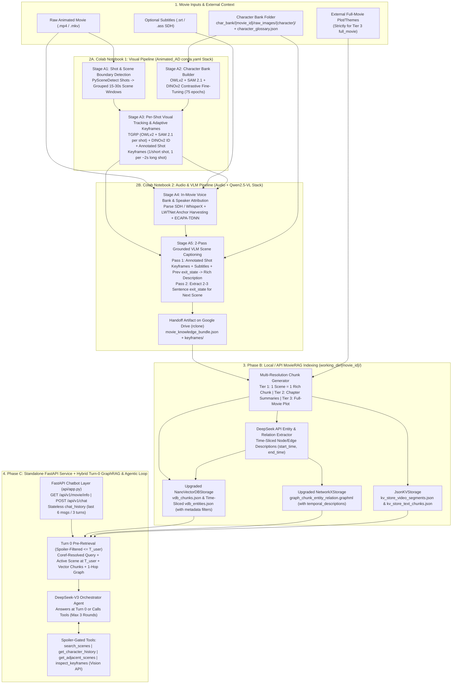

# MovieRAG: Animated Movie Multimodal Knowledge Base & Spoiler-Aware RAG

> **Master Architecture & Design Index**
> This note serves as the central hub for the end-to-end MovieRAG architecture. It connects the offline animated character recognition pipeline (`Animated_AD`) with our spoiler-aware, multi-resolution, agentic `MovieRAG` engine.

---

## Sub-Notes Index
1. **[[01_PhaseA_Animated_AD_Pipeline]]** — Shot-aligned scene windowing, semi-automated visual character bank (`DINOv2` + `character_glossary.json`), per-shot TGRP tracking (`OWLv2` + `SAM 2.1`), adaptive per-shot annotated keyframe sampling, hybrid speaker attribution (`SDH` / `WhisperX` + `LWTNet` + `ECAPA-TDNN`), and 2-pass character-grounded VLM scene captioning.
2. **[[02_Data_Handoff_and_Storage_Schemas]]** — Exact JSON specifications for `movie_knowledge_bundle.json`, 1-Scene = 1-Chunk `TextChunkSchema`, `NanoVectorDB` metadata fields (including time-sliced rich `entities_vdb`), and time-sliced `NetworkX` graph node/edge schemas.
3. **[[03_Spoiler_Aware_GraphRAG_and_Retrieval]]** — Dual-layer 3-tier knowledge indexing (`scene`, `chapter`, `full_movie`), time-sliced entity/relation merging, straddle-safe timestamp filtering (`T_user`), **Multi-Turn Conversation Memory (`chat_history`)**, and the **Hybrid Turn-0 GraphRAG + Bounded Agentic Tool-Calling Loop (`DeepSeek-V3` + `inspect_keyframes` Vision Sub-Tool)**.
4. **[[04_Implementation_Roadmap_and_Milestones]]** — Step-by-step file modification blueprint across `MovieRAG/`, `api/app.py` (Standalone FastAPI Chatbot Service), and `Animated_AD/`, dependency cleanup, and validation milestones starting with `Sintel.mp4`.

---

## 1. Core Architectural Pillars

| Pillar | Decision Locked In | Why It Solves Previous Bottlenecks |
| :--- | :--- | :--- |
| **1. Per-Shot Annotated Keyframes + 2-Pass VLM Captioning** | Sample 1 sharpest frame per short shot ($<2\text{s}$) and 1 per ~2s in longer shots, draw colored character bounding boxes, and run a **2-pass VLM workflow** (`Pass 1`: full vision attention for a rich `300–600` token scene description; `Pass 2`: concise 2–3 sentence `exit_state` for next-scene continuity). | Captures every camera cut without motion blur, prevents previous-scene temporal bleed, and keeps 100% of VLM vision attention on the current scene. |
| **2. Per-Shot Tracking $\rightarrow$ Grouped Scene Windows** | Keep `TGRP` (`OWLv2` + `SAM 2.1`) running per camera shot (respecting hard cuts), then group contiguous shots into **15–30s semantic scenes**. | Prevents `SAM 2.1` pixel masks from breaking across hard camera cuts while giving the VLM and RAG index complete multi-shot narrative scenes. |
| **3. 3-Tier Multi-Resolution Index (`1 Scene = 1 Chunk`)** | **Tier 1 (`scene`)**: 1 Scene = 1 rich chunk (`400–1,000+` tokens of Pass-1 visual breakdown + speaker-tagged subtitles, no multi-scene squeezing).<br>**Tier 2 (`chapter`)**: 5–10 min progressive summaries.<br>**Tier 3 (`full_movie`)**: External plot/theme analysis (`end_time = duration`, unlocked only when `spoiler_free = False`). | Preserves exhaustive visual and subtitle detail per scene while keeping `external_plot` strictly isolated in Tier 3 so early tiers never leak spoilers. |
| **4. Time-Sliced Knowledge Graph & Rich `entities_vdb`** | Store `temporal_descriptions: [{start_time, end_time, tier, description}]` on every graph node/edge AND store time-sliced rich entity embeddings in `entities_vdb` with `start_time`/`end_time` metadata. | Gives `entities_vdb` full semantic description recall while strictly blocking future character twists or unintroduced entities when `spoiler_free = True`. |
| **5. Hybrid Turn-0 GraphRAG + Agentic Tool-Calling Loop** | **Turn 0**: Auto-injects the Active Scene at `T_user` + Spoiler-Filtered Original GraphRAG output (Vector Chunks + Entity Rewrite $\rightarrow$ 1-Hop Graph Co-Occurrence Scenes + Graph Entity/Edge Histories $\le T_{\text{user}}$).<br>**Rounds 1–3**: `DeepSeek-V3` either answers immediately (0 tool calls) or invokes spoiler-gated tools (`search_scenes`, `get_character_history`, `get_adjacent_scenes`, `inspect_keyframes`). | Combines zero-hop speed for ~80% of queries with multi-hop graph/timeline investigation and on-demand Vision API keyframe inspection (`Option A`) for hard queries. |
| **6. Hybrid Compute & 2-Notebook Colab Split** | **Notebook 1 (`PhaseA1_Visual_Pipeline.ipynb`)**: `Animated_AD/conda.yaml` visual stack (`PySceneDetect`, `OWLv2`, `SAM 2.1`, `DINOv2`) $\rightarrow$ `shots_and_scenes.json`, `visual_tracks_per_frame.json`, `keyframes/`.<br>**Notebook 2 (`PhaseA2_Audio_and_VLM.ipynb`)**: Audio + VLM stack (`WhisperX`, `LWTNet`, `ECAPA-TDNN`, `Qwen2.5-VL-7B`) $\rightarrow$ `movie_knowledge_bundle.json`.<br>**Phase B & C (Local CPU)**: `DeepSeek API` + local `nomic-embed-text` + Vision Sub-Tool API + FastAPI (`api/app.py`). | Eliminates CUDA/PyTorch dependency clashes between `SAM 2.1`/`xformers` and `WhisperX`/`SpeechBrain`/`Qwen2.5-VL`, while keeping zero GPU requirements for indexing and live chatbot serving. |

---

## 2. End-to-End System Architecture Diagram



---

## 3. Directory & Workspace Organization

```text
MovieRag/
├── Animated_AD/                      # Upstream + adapted CV/Audio character recognition modules
├── MovieRAG/                         # Modified VideoRAG package (spoiler-aware indexing & agentic query)
│   └── videorag/
│       ├── base.py                   # Extended QueryParam (with chat_history) & 1-Scene=1-Chunk TextChunkSchema
│       ├── videorag.py               # Added insert_knowledge_bundle() & VDB metadata fields
│       ├── _llm.py                   # Added deepseek_config (with tool calling) & vision_subtool_func
│       ├── _op.py                    # Time-sliced KG merge, Turn-0 GraphRAG context & 3-round Agent Loop
│       └── _storage/
│           └── vdb_nanovectordb.py   # Added filter_lambda support to NanoVectorDBStorage.query()
├── api/                              # Lightweight Standalone Chatbot API Layer (CPU-only, zero GPU)
│   └── app.py                        # FastAPI service (/api/v1/movie/info, /api/v1/chat)
├── notebooks/                        # Environment-isolated Google Colab Pro notebooks for Phase A
│   ├── PhaseA1_Visual_Pipeline.ipynb # Stages A1-A3 (PySceneDetect + OWLv2 + SAM 2.1 + DINOv2)
│   └── PhaseA2_Audio_and_VLM.ipynb   # Stages A4-A5 (WhisperX + LWTNet + ECAPA-TDNN + Qwen2.5-VL-7B)
├── pipeline/                         # Orchestration scripts for Phase A (Colab GPU) -> Handoff JSON
│   ├── stage1_scenes.py              # Shot detection & 15-30s shot-aligned scene grouping
│   ├── stage2_charbank.py            # Semi-automated char_bank folder + DINOv2 contrastive tuning
│   ├── stage3_visual_recog.py        # Per-shot TGRP + DINOv2 ID + adaptive annotated shot-keyframe extraction
│   ├── stage4_subtitles.py           # SDH parser / WhisperX + LWTNet AV-sync + ECAPA-TDNN attribution
│   └── stage5_vlm_caption.py         # 2-Pass VLM captioner (Pass 1: rich caption, Pass 2: exit_state)
├── workdir/                          # Per-movie isolated knowledge bases (synced via rclone)
│   └── {movie_id}/
│       ├── movie_knowledge_bundle.json
│       ├── keyframes/                # Adaptive per-shot keyframes (with character bboxes drawn)
│       ├── kv_store_video_segments.json
│       ├── kv_store_text_chunks.json
│       ├── vdb_chunks.json
│       ├── vdb_entities.json
│       └── graph_chunk_entity_relation.graphml
└── Notes/                            # Architecture & design documentation
```
