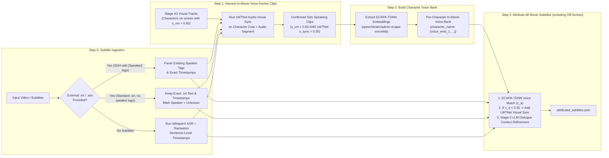
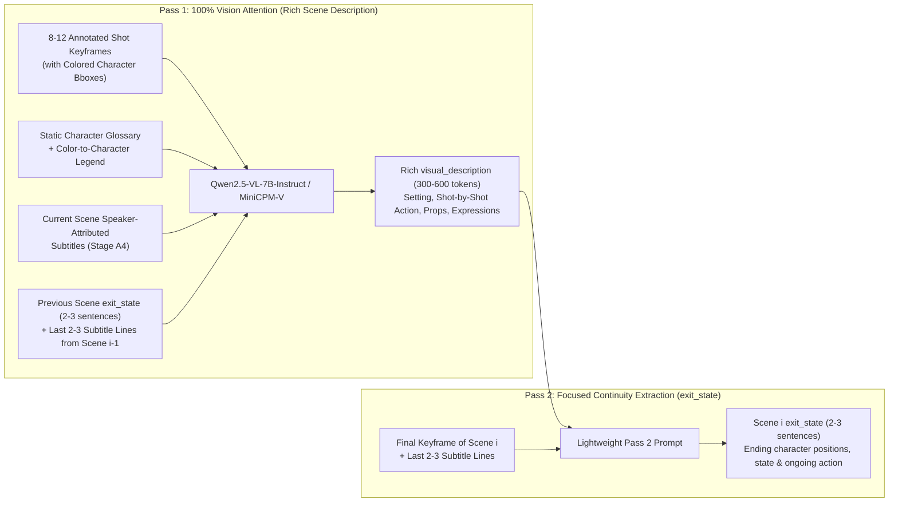

# Phase A: Animated Character & Grounded VLM Pipeline (`Animated_AD`)

> Part of [[00_MovieRAG_Master_Plan]]
> Covers the GPU-heavy offline extraction stages designed to run on **Google Colab Pro (L4 24GB VRAM recommended, T4 16GB supported)**. Following `Animated_AD`'s exact environment separation, Phase A is divided into **2 environment-isolated Colab Notebooks** communicating via Google Drive JSON checkpoints so `SAM 2.1`/`xformers` never clash with `WhisperX`/`SpeechBrain`/`Qwen2.5-VL`.

---

## 0. Two-Notebook Colab Environment Isolation (`notebooks/`)

| Colab Notebook | Environment Stack | Stages Executed | Inputs (from Drive) | Outputs (saved to Drive) |
| :--- | :--- | :--- | :--- | :--- |
| **Notebook 1: `PhaseA1_Visual_Pipeline.ipynb`** | Exact `Animated_AD/conda.yaml` Visual Stack:<br>• `PySceneDetect` + `OpenCV`<br>• `OWLv2` (`transformers`)<br>• `SAM 2.1` (`sam2` + `xformers`)<br>• `DINOv2` (`pytorch 2.5.1 + cu124`) | **Stage A1**: Shot detection & 15–30s scene grouping<br>**Stage A2**: `DINOv2` 75-epoch character bank tuning<br>**Stage A3**: Per-shot `TGRP` tracking, `DINOv2` ID, & **Adaptive Per-Shot Annotated Keyframes** | • `movie.mp4`<br>• `char_bank/{movie_id}/` | • `shots_and_scenes.json`<br>• `visual_tracks_per_frame.json`<br>• `keyframes/*.jpg` (with colored bboxes drawn) |
| **Notebook 2: `PhaseA2_Audio_and_VLM.ipynb`** | Audio + VLM Stack (zero `sam2`/`xformers` conflicts):<br>• `WhisperX` (only if no `.srt`)<br>• `LWTNet` + `SpeechBrain` (`ECAPA-TDNN`)<br>• `Qwen2.5-VL-7B-Instruct` | **Stage A4**: In-movie `LWTNet` voice harvesting + `ECAPA-TDNN` subtitle speaker attribution (flushes VRAM when done)<br>**Stage A5**: **2-Pass `Qwen2.5-VL-7B` Scene Captioning** (`Pass 1: vlm_caption`, `Pass 2: exit_state`) | • `movie.mp4` + `.srt`<br>• `shots_and_scenes.json`<br>• `visual_tracks_per_frame.json`<br>• `keyframes/*.jpg`<br>• `character_glossary.json` | • `attributed_subtitles.json`<br>• **`movie_knowledge_bundle.json`** (Final Handoff Artifact) |

---

## 1. Stage A1: Shot Detection & Hierarchical Scene Windowing (`stage1_scenes.py`)

### Shots vs. Scenes: Why Both Levels Matter
- **Camera Shot (`1.5s – 5s` typical)**: A single continuous camera take between two hard cuts. `SAM 2.1` object tracking in `Animated_AD/character_recognition/visual_recognition/tgrp.py` **must run inside individual camera shots** because pixel-level mask propagation breaks if it crosses a hard camera cut.
- **Scene Window (`15s – 30s` typical)**: A narrative unit consisting of multiple consecutive shots in the same setting/conversation. Stage A5 (VLM Captioning) and Tier-1 RAG indexing operate on **grouped Scene Windows** so the VLM and LLM understand the complete sequence of cuts and dialogue.

### Shot-to-Scene Grouping Algorithm
1. **Shot Boundary Detection**:
   - Run `PySceneDetect` (`ContentDetector()`) via `shot_boundary_detection()` from `tgrp.py` to obtain exact camera shots `[(start_frame, end_frame), ...]`.
   - If a single unbroken camera take exceeds `max_shot_duration = 20.0s` (e.g., a long continuous panning shot), subdivide it into `15.0s` sub-shots so `SAM 2.1` mask propagation never runs out of VRAM.
2. **Scene Window Merging (`target = 15–30s`)**:
   - Group contiguous shots into a **Scene Window** until adding the next shot would exceed `max_scene_duration = 30.0s` (with `min_scene_duration = 12.0s`).
   - Each Scene Window stores its constituent `shot_ranges` so shot-level character tracks and per-shot keyframes map 1-to-1 into the scene.

---

## 2. Stage A2: Semi-Automated Visual Character Bank (`stage2_charbank.py`)

### Workflow
In `CharacterRecognition.pdf` (Table A1), curating 8–10 clean exemplar images per character improved bounding-box mAP from `37.2%` to `45.3%`. We use a clean folder structure where `character_glossary.json` serves as the text companion to the reference images:

1. **Folder Structure**:
   ```text
   char_bank/{movie_id}/
   ├── character_glossary.json       # Spoiler-free 1-line visual/role description per character
   └── raw_images/
       ├── Sintel/
       │   ├── Sintel_0.png          # Profile/anchor image
       │   ├── Sintel_1.png ...      # 5-10 varied poses/expressions/angles
       ├── Scales/
       └── Shaman/
   ```
   - **How `character_glossary.json` is prepared**: Created alongside the character reference folders as a 1-sentence visual/premise anchor per character (or optionally drafted by a helper script from `{character}_0.png` + initial character bio). It gives Stage A5's VLM a consistent visual identity for every character from Scene 0 onward, even before their name is spoken in dialogue.
2. **Optional Web Crawler Fallback**:
   - If `raw_images/` has fewer than 5 images for a character, optionally invoke `Animated_AD/build_character_bank/build_appearance_bank/build_online.py` + `clustering.py` (using `OWLv2` + `DINOv2` prototype disambiguation).
3. **Movie-Specific `DINOv2` Contrastive Fine-Tuning**:
   - Run `Animated_AD/build_character_bank/feature_extraction/finetune.py`:
      - Base model: `DINOv2 ViT-g/14` (4 register tokens) on L4 24GB, or `ViT-L/14` on T4 16GB.
      - Updates final linear layer for `75 epochs` using InfoNCE loss ($\tau = 0.07$, $\text{lr} = 6\times 10^{-4} \rightarrow 5\times 10^{-6}$).
   - Run `feature_extraction.py` to precompute normalized exemplar embeddings `{character_name: [feat_1, ..., feat_n]}`.

---

## 3. Stage A3: Per-Shot Visual Tracking & Adaptive Annotated Keyframes (`stage3_visual_recog.py`)

Wraps `tgrp.py`, `classification.py`, and `postprocessing.py` from `Animated_AD/character_recognition/visual_recognition/`, and extracts **adaptive per-shot keyframes with character bounding boxes drawn**:

1. **Track-Guided Region Proposals (TGRP — Per Individual Shot)**:
   - Runs strictly **per individual camera shot** from Stage A1:
     - Sample 3 seed frames (1 from each third of the shot).
     - Run `google/owlv2-large-patch14-ensemble` with text prompt `[["a photo of an animated character"]]` (threshold `0.1`, NMS IoU `0.5`).
     - Prompt `SAM 2.1` (`sam2.1_hiera_l.yaml`) with each detected box and propagate masks **bidirectionally** (forward + reverse) within the shot boundaries.
     - Perform **tripartite graph matching** (Hungarian assignment across the 3 seed sets, keeping connected components spanning $\ge 2$ seed sets with average $\text{IoU} \ge 0.5$).
   - **Resumable Checkpointing**: Each finished shot appends one line to `tgrp_tracks.jsonl` and calls `release_inference_state()` + `torch.cuda.empty_cache()`.
2. **DINOv2 Track Classification & Global Frame Mapping**:
   - Uniformly sample 5 frames along each valid character track, crop the character region, and extract features using the fine-tuned `DINOv2` model from Stage A2.
   - Compute visual matching score $s_{\text{vm}}^p = \max_j \left(\frac{1}{3} \sum_{\text{top-3}, i} \langle f_j, z_i^p \rangle \right)$ against each character $C^p$ in the bank.
   - Retain character labels with $s_{\text{vm}} > 0.45$ for visual prompting (and $s_{\text{vm}} > 0.60$ for in-movie voice bank harvesting).
   - Map shot-relative tracks back to global movie frame indices (`visual_tracks_per_frame.json`) via `postprocessing.py`.
3. **Adaptive Per-Shot Sharp Keyframe Extraction (with Drawn Bounding Boxes)**:
   - Instead of uniform per-scene frame sampling (which skips short shots and hits motion blur), we sample keyframes **adaptively per shot**:
     - **Short shots ($< 2.0\text{s}$)**: Pick **1 sharpest frame** across the shot using OpenCV **Variance of the Laplacian** (`cv2.Laplacian(gray, cv2.CV_64F).var()`).
     - **Longer shots ($\ge 2.0\text{s}$)**: Divide the shot into `~2.0s` intervals and pick **1 sharpest frame per 2-second interval**.
     - *(Result: A typical 20s scene with 6 shots yields `8–12` crystal-clear keyframes covering every single camera cut; a 90-minute movie yields ~2,700 JPEG keyframes $\approx 180\text{ MB}$.)*
   - **Pre-Drawn Character Bounding Boxes**:
     - On each selected shot-keyframe, draw the color-coded bounding boxes for all recognized characters ($s_{\text{vm}} > 0.45$) using a consistent per-scene color palette (`red`, `green`, `blue`, `yellow`, `pink`, `cyan`).
     - Save the annotated keyframe to `workdir/{movie_id}/keyframes/{scene_id}_shot{shot_idx}_{timestamp:.2f}s.jpg` alongside its character legend metadata.
     - Both **Stage A5 (offline VLM scene captioning)** and **Phase C (`inspect_keyframes` query-time Vision API sub-tool)** use these exact annotated shot-keyframes!

---

## 4. Stage A4: In-Movie Self-Bootstrapped Voice Bank & Speaker Attribution (`stage4_subtitles.py`)

Combines your priority for **SDH / `.srt` subtitles** (from [[Captioning_Context]]) with `Animated_AD`'s audio-visual speaker recognition (`LWTNet` + `ECAPA-TDNN`) so off-screen dialogue, reaction shots, and group scenes are accurately attributed without needing to crawl YouTube actor interviews:



### How the 3-Step In-Movie Speaker Attribution Works
1. **Step 1 — Harvest High-Confidence Anchor Clips (`TGRP` + `LWTNet`)**:
   - From Stage A3 (`visual_tracks_per_frame.json`), we identify every shot where a character $C$ is visibly on screen with high visual confidence ($s_{\text{vm}} > 0.60$).
   - For subtitle segments overlapping those shots, we crop Character $C$'s bounding-box tube across the video frames and run **`LWTNet`** (`Animated_AD/character_recognition/audio_recognition/lwtnet/`) to measure lip/head motion synchronization ($s_{\text{sync}}$) with the audio waveform.
   - Whenever a single character has strong lip-sync ($s_{\text{sync}} > 0.30$), that audio segment is harvested as a verified ground-truth voice sample for Character $C$.
2. **Step 2 — Construct the `ECAPA-TDNN` Character Voice Bank**:
   - Pass each character's verified in-movie audio segments through **`ECAPA-TDNN`** (`speechbrain/spkrec-ecapa-voxceleb`) to build `{character_name: [voice_emb_1, ...]}`.
   - **Why this beats YouTube interview crawling (`interview_crawling.py`)**: Animated voices are heavily pitched/stylized compared to natural actor interviews. Bootstrapping the voice bank directly from high-confidence on-screen speaking shots captures the exact in-movie character voice (`interview_crawling.py` or manual audio clips remain an optional fallback only for characters with $<3$ on-screen speaking shots).
3. **Step 3 — Classify All Subtitle Lines (`audio_recognition.py` + `subtitling_recog.py`)**:
   - For every subtitle line in the movie (including **off-screen speech**, **reaction shots**, and **crowded scenes**):
     - Compute `ECAPA-TDNN` audio similarity $c_a$ against the Character Voice Bank.
     - If $c_a \ge 0.35$, assign the matched character directly.
     - If $c_a < 0.35$ (short exclamation or heavy background score), run `visual_enhanced_audio_recognition()` combining $c_a$ with `LWTNet` sync scores $s_{\text{sync}}$ of the characters currently visible on screen, followed by the Stage-2 LLM dialogue context refinement pass (`subtitling_recog.py`).

---

## 5. Stage A5: Two-Pass Grounded VLM Scene Captioning (`stage5_vlm_caption.py`)

Replaces both `AutoAD-Zero` Stage 1 (`Animated_AD/app/AutoAD-Zero/stage1_qwenvl/`) and `MovieRAG`'s raw `segment_caption()` (`MovieRAG/videorag/_videoutil/caption.py`).

### Why We Use a 2-Pass Design Per Scene
Because **1 Scene = 1 Rich Tier-1 Chunk (`400–1,000+` tokens)**, passing the *entire* previous scene's 600-token description into the VLM while it inspects 8–12 keyframes of the current scene can cause **temporal bleed** (the VLM re-describes actions from Scene $i-1$ as if they are happening in Scene $i$) or split the VLM's attention if asked to write both a long description and a summary simultaneously.

Instead, we execute **2 focused passes per scene**:



1. **Pass 1 — Detailed Scene Breakdown (`visual_description`)**:
   - **Inputs**:
     - The `8–12` adaptive per-shot keyframes for Scene $i$ (with colored character bounding boxes already drawn),
     - **Static Character Glossary** (1-line visual/role premise for characters present in the scene or subtitles),
     - **Color-to-Character Mapping**: e.g., `"Characters labeled by colored boxes across these shots: Sintel (red), Shaman (green). Use their names directly; do NOT mention box colors."`,
     - **Previous Scene Continuity Context**: The 2–3 sentence `exit_state` + last 2–3 lines of attributed subtitles from `scene_index - 1`,
     - **Current Scene Character-Attributed Subtitles**.
   - **Task**: `Qwen2.5-VL-7B-Instruct` (or `MiniCPM-V-2_6`) focuses 100% of its vision attention on writing an exhaustive, multi-paragraph `visual_description` (`300–600` tokens) covering:
     1. Environment, lighting, and key props across shots,
     2. Chronological shot-by-shot physical actions and movements,
     3. Character-to-character interactions,
     4. Facial expressions, body language, and emotional tone.
2. **Pass 2 — Exit-State Extraction (`exit_state`)**:
   - **Inputs**: Pass 1's `visual_description` + the final keyframe of Scene $i$ + the last 2–3 subtitle lines of Scene $i$.
   - **Task**: Outputs a compact 2–3 sentence `exit_state` stating the exact ending physical positions, held objects/props, emotional state, and ongoing action of each character at the end of Scene $i$.
   - This `exit_state` is saved to `movie_knowledge_bundle.json` and passed forward into Scene $i+1$'s Pass 1 prompt.
3. **Output**: Writes the complete `movie_knowledge_bundle.json` (see [[02_Data_Handoff_and_Storage_Schemas]]).
