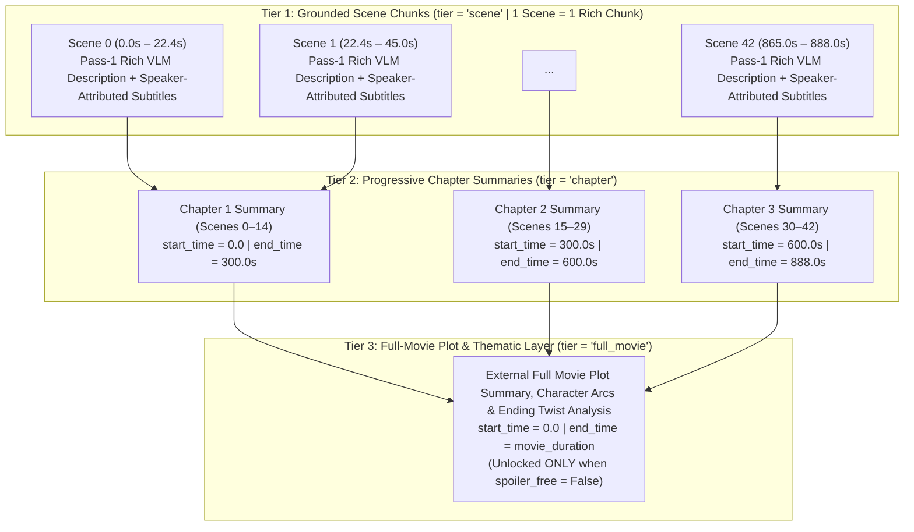
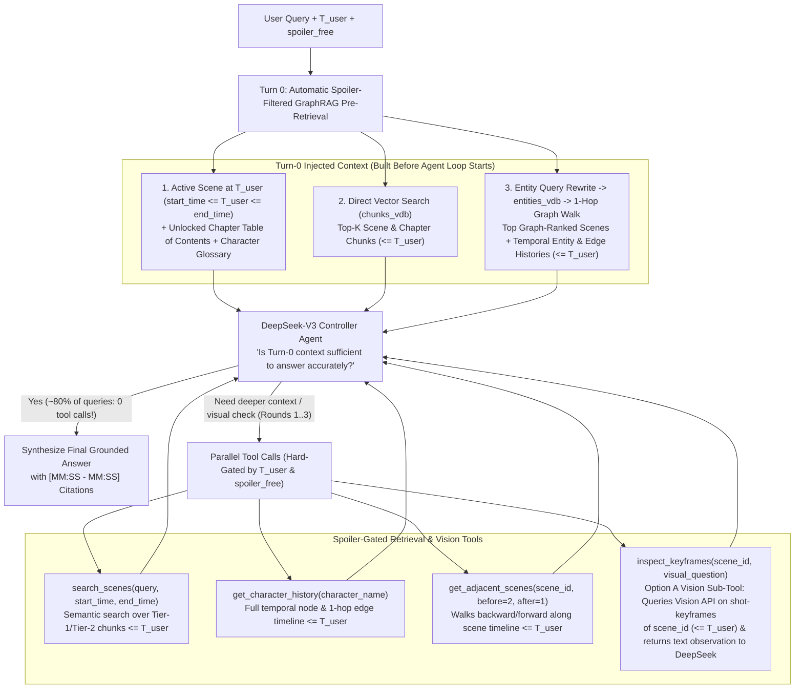

# Spoiler-Aware GraphRAG & Agentic Retrieval Architecture

> Part of [[00_MovieRAG_Master_Plan]]
> Details the **Dual-Layer 3-Tier Multi-Resolution Index (`1 Scene = 1 Chunk`)**, **Time-Sliced Knowledge Graph & `entities_vdb`**, **Straddle-Safe Cutoff Logic**, **`spoiler_free` Toggle**, **Multi-Turn Conversation Memory (`chat_history`)**, and the **Hybrid Turn-0 GraphRAG + Bounded Agentic Tool-Calling Retrieval Loop**.

---

## 1. Dual-Layer Multi-Resolution Knowledge Indexing (`1 Scene = 1 Chunk`)

To support both **strict spoiler-free watching (`spoiler_free = True` at `T_user`)** and **deep full-movie analysis (`spoiler_free = False`)** without contaminating early scene captions, knowledge is indexed into three resolution tiers:



### How Each Tier Is Built During `insert_knowledge_bundle()`
1. **Tier 1 (`scene` — `1 Scene = 1 Rich Chunk`)**:
   - Each scene in `movie_knowledge_bundle.json` becomes **one dedicated Tier-1 chunk** (`400–1,000+` tokens combining the rich Pass-1 VLM `visual_description` and the timestamped speaker-attributed `subtitles`).
   - We do **not** pack multiple scenes into an 800-token window; `chunk_token_size` is raised to `2048` tokens so every scene retains its full shot-by-shot visual and dialogue fidelity with exact `start_time` and `end_time`.
   - External plot documents are **never** injected into Tier 1 or Tier 2 generation so early chunks cannot accidentally foreshadow late-movie twists.
2. **Tier 2 (`chapter`)**:
   - Every ~5–10 minutes of movie time (e.g., `chapter_window_sec = 300.0`), DeepSeek API (`deepseek-chat`) summarizes the constituent Tier 1 scene descriptions + dialogues into a cohesive 1–2 paragraph chapter narrative.
   - Stamped with `tier = "chapter"`, `start_time = chapter_start`, `end_time = chapter_end`.
   - When a user is at `T_user = 450s` (`00:07:30`) with `spoiler_free = True`, Chapter 1 (`end_time = 300.0 <= 450.0`) is unlocked to give the LLM macro story context up to that point.
3. **Tier 3 (`full_movie`)**:
   - Ingests `external_plot_documents` (Wikipedia/Fandom plot summaries, thematic analyses, character arcs) plus a synthesized overview across all chapters.
   - Stamped with `tier = "full_movie"`, `start_time = 0.0`, `end_time = movie_duration` (strictly locked when `spoiler_free = True`).

---

## 2. Time-Sliced Entity & Relationship Merging (`_op.py`)

### The Spoiler Bug in Vanilla VideoRAG
In `MovieRAG/videorag/_op.py`, `_merge_nodes_then_upsert()` and `_merge_edges_then_upsert()` combine every extracted fact about an entity across the entire movie into a single string `description` summarized by `_handle_entity_relation_summary()`.
- If `SCALES` is extracted at `00:01:00` (*"Scales is a baby dragon rescued by Sintel"*) and at `00:12:00` (*"The adult dragon killed by Sintel is revealed to be Scales"*), the single node summary contains the ending twist!
- Furthermore, vanilla `videorag_query()` in `_op.py` only used the Knowledge Graph to count 1-hop chunk co-occurrences (`_find_most_related_segments_from_entities`) and **discarded** the actual node and edge descriptions before calling the answer LLM.

### The Upgraded Time-Sliced Solution
1. **During Indexing (`extract_entities`)**:
   - When `_handle_single_entity_extraction()` or `_handle_single_relationship_extraction()` extracts a record from `chunk_key`, we attach the chunk's `start_time`, `end_time`, and `tier`:
     ```python
     {
         "chunk_id": chunk_key,
         "start_time": chunk_dp["start_time"],
         "end_time": chunk_dp["end_time"],
         "tier": chunk_dp["tier"],
         "description": entity_description,
     }
     ```
   - In `_merge_nodes_then_upsert()` and `_merge_edges_then_upsert()`, we append these dicts to `temporal_descriptions` (sorted by `start_time`) and compute `first_seen_time = min(d["start_time"] for d in temporal_descriptions)`.
   - In `entities_vdb`, we upsert **one rich vector record per temporal slice** (`f"{entity_name}: {d['description']}"` with metadata `start_time`, `end_time`, `tier`) so vector search gets full descriptive recall while filtering out slices with `start_time > T_user`!

2. **During Retrieval (`_find_most_related_segments_from_entities` + Graph Context Builder)**:
   - When `spoiler_free = True` and `current_timestamp = T_user`:
     1. **Filter `entities_vdb`**: Query `entities_vdb` with `filter_lambda` requiring `start_time <= T_user` and `tier != "full_movie"`, then deduplicate `entity_name`s.
     2. **Hide Unintroduced Entities**: Discard any graph node where `node["first_seen_time"] > T_user`.
     3. **Reconstruct Spoiler-Safe Node & Edge Histories**: Filter each matched node and 1-hop edge's `temporal_descriptions` to keep only events where:
        $$\text{tier} \neq \text{"full\_movie"} \quad \land \quad \text{start\_time} \le T_{\text{user}}$$
     4. **Rank 1-Hop Co-Occurring Scene Chunks**: Run `_find_most_related_segments_from_entities()` restricted to source chunks with `start_time <= T_user` and `tier != "full_movie"`.
     5. **Inject Both**: Unlike vanilla `VideoRAG`, we inject **both** the Graph-Ranked Scene Chunks **and** the reconstructed **Graph Entity & Relationship Histories** into the Turn-0 prompt!

---

## 3. Straddle-Safe Temporal Cutoff Rule

When a user pauses at $T_{\text{user}} = \text{00:08:45}$ (`525.0s`):
- A scene spanning `[492.0s, 535.0s]` straddles $T_{\text{user}} = 525.0\text{s}$.
- If we used a naive `end_time <= T_user` filter on scenes, the scene the user is currently watching would be dropped!
- Instead, every retrieval channel and agent tool enforces the **Straddle-Safe Filter**:
  - **For `tier == "scene"`**: Allow any scene where `start_time <= T_user`.
  - **For `tier == "chapter"`**: Require `end_time <= T_user` (a chapter summary is only safe once the viewer has completed that chapter).
  - **For `tier == "full_movie"`**: Require `spoiler_free == False`.
  - **Subtitle Clipping on Straddling Scenes**: Whenever a scene has `start_time <= T_user < end_time` and `spoiler_free == True`, dynamically format its `[Subtitles / Dialogue]` block by filtering `subtitles` to `utt["start_time"] <= T_user`. Any line spoken after `T_user` is stripped before reaching the LLM.

---

## 4. Hybrid Turn-0 GraphRAG + Bounded Agentic Tool-Calling Loop

### Why Hybrid Turn-0 + Agentic Tools Is Best
In vanilla `VideoRAG` ([`MovieRAG/videorag/_op.py:694-858`](file:///home/tris/TRIS_WORKS/ctu-flix/MovieRag/MovieRAG/videorag/_op.py#L694-L858)), retrieval was a rigid single-pass pipeline that ran LLM Yes/No filters on every segment and loaded local `MiniCPM-V` at query time to re-caption raw video frames for every query.

Our upgraded architecture combines **Turn-0 Spoiler-Filtered GraphRAG Pre-Retrieval** (giving the LLM all the context of the original pipeline immediately at Turn 0) with **Bounded Agentic Tool-Calling (`DeepSeek-V3`, Max 3 Rounds)** so the LLM can decide if Turn 0 is already enough or if it needs to fetch more scenes, character histories, or inspect visual keyframes!



### Side-by-Side Comparison: Original `VideoRAG` Context vs. New Turn-0 Context

| Context Block | Original `VideoRAG` (`_op.py:849`) | New **Turn-0 Injected Context** |
| :--- | :--- | :--- |
| **1. Viewer State & Active Scene at `T_user`** | ❌ None | ✅ Injects `T_user`, `spoiler_free` status, unlocked Chapter Table of Contents, and the full **Active Scene Chunk at `T_user`** (with subtitles clipped at `<= T_user`). |
| **2. Direct Vector Chunks (`chunk_data`)** | ✅ Top-K chunks from `chunks_vdb` (unfiltered). | ✅ Top-K Tier-1 `scene` & Tier-2 `chapter` chunks from `chunks_vdb` (strictly filtered by `T_user` & `spoiler_free`). |
| **3. Graph-Retrieved Knowledge** | ⚠️ Uses LLM entity rewrite + `entities_vdb` + 1-hop graph `relation_counts` only to find `video_segment_id`s; **discards** graph node/edge descriptions; runs live MiniCPM-V on raw video to build `video_data` CSV. | ✅ Runs LLM entity rewrite + time-sliced `entities_vdb` + 1-hop graph `relation_counts` and injects **both**:<br>• The **Top Graph-Ranked Scene Chunks** (deduplicated against Vector Chunks), and<br>• The **Temporal Entity & Relationship Descriptions** (`start_time <= T_user`) from the Knowledge Graph. |
| **4. Visual Keyframe Inspection** | Forced local MiniCPM-V re-captioning on every remaining segment on every query. | ⚡ **On-Demand via `inspect_keyframes(scene_id, visual_question)` (Option A)**: `DeepSeek-V3` calls this tool only when the user asks a fine-grained visual question or when a scene caption lacks a needed visual detail. |

### Concrete Turn-0 Prompt Layout Sent to `DeepSeek-V3`
```xml
<viewer_state>
  Movie: Sintel | Current Watch Timestamp (T_user): 00:08:45 (525.0s) | Spoiler-Free Mode: ON
  Unlocked Chapters up to T_user:
  - Chapter 1 [00:00:00 - 00:05:00]: Sintel's Mountain Journey & Finding Scales
</viewer_state>

<current_scene_at_T_user>
  [SCENE sintel_scene_0012 | 00:08:12 - 00:08:55 | Characters: Sintel, Scales]
  [Visual Description]:
  Across 4 shots, Sintel sprints up the snowy ridge clutching her staff while Scales circles overhead...
  [Subtitles / Dialogue (clipped at 00:08:45)]:
  - [00:08:15 - 00:08:18] Sintel: "Scales, stay back!"
</current_scene_at_T_user>

<graph_entities_and_relations_up_to_T_user>
  Entity [SINTEL] (first seen 00:00:12):
    - [Glossary]: Young woman searching for her pet dragon Scales; wears a brown cloak and carries a staff.
    - [00:02:10 - 00:03:05]: Found injured baby dragon Scales in the snow and bandaged his wing.
  Relation [SINTEL <-> SCALES]:
    - [00:02:10 - 00:08:00]: Sintel nurses Scales back to health; Scales flies beside her on her journey.
</graph_entities_and_relations_up_to_T_user>

<retrieved_scene_and_chapter_chunks_up_to_T_user>
  <!-- Union of Direct Vector Search (chunks_vdb) + 1-Hop Graph Co-Occurrence Search -->
  [SCENE sintel_scene_0005 | 00:02:10 - 00:03:05 | Source: Graph+Vector]: ...
  [CHAPTER sintel_chap_0001 | 00:00:00 - 00:05:00 | Source: Vector]: ...
</retrieved_scene_and_chapter_chunks_up_to_T_user>
```

---

## 5. Specification of the 4 Spoiler-Gated Agent Tools (Max 3 Rounds)

All 4 tools are bound via OpenAI-compatible `tools` schema on `deepseek-chat`. **Crucially, `T_user` and `spoiler_free` are bound inside the Python tool closures on the server side**, so the LLM can never bypass the spoiler cutoff even if it requests a future timestamp:

1. **`search_scenes(query: str, start_time: float = 0.0, end_time: float = None) -> str`**:
   - Clamps `effective_end = min(end_time or T_user, T_user)` when `spoiler_free = True`.
   - Queries `chunks_vdb` with `filter_lambda` (`start_time >= start_time` and straddle-safe `<= effective_end`) and returns up to 5 formatted scene/chapter chunks (with subtitles clipped at `T_user`).
2. **`get_character_history(character_name: str) -> str`**:
   - Fuzzy-matches `character_name` against the Knowledge Graph nodes and `entities_vdb` ($\le T_{\text{user}}$).
   - Returns the character's glossary entry, chronological `temporal_descriptions` ($\le T_{\text{user}}$), and all 1-hop relationship edges (`temporal_descriptions` $\le T_{\text{user}}$) with the scene IDs where each interaction occurred.
3. **`get_adjacent_scenes(scene_id: str, before: int = 2, after: int = 1) -> str`**:
   - Fetches the scenes immediately preceding and succeeding `scene_id` from `kv_store_video_segments.json`.
   - When `spoiler_free = True`, any succeeding scene with `start_time > T_user` is blocked, and any straddling scene has its subtitles clipped at `T_user`.
4. **`inspect_keyframes(scene_id: str, visual_question: str) -> str` (Option A: Vision Sub-Tool)**:
   - Looks up the pre-extracted, bbox-annotated shot-keyframes for `scene_id` in `kv_store_video_segments.json`, keeping only keyframes with `timestamp <= T_user` when `spoiler_free = True`.
   - Sends up to 4 sharp shot-keyframes + the character color legend + `visual_question` to the configured **Vision API** (`Qwen2.5-VL-72B-Instruct`, `gemini-2.5-flash`, or `gpt-4o-mini`).
   - Returns the Vision API's detailed visual observation as a tool response string back to `DeepSeek-V3`.

### Iteration Budget & Termination
- **Max Rounds**: `max_tool_rounds = 3` (parallel tool calls allowed within each round).
- If the agent reaches Round 3 and still attempts a tool call, we strip `tools` from the final API call and instruct `DeepSeek-V3` to synthesize the best possible grounded answer from all context gathered across Turns 0–3.

---

## 6. Multi-Turn Conversation Memory (`chat_history`)

To support natural follow-up questions during a watch session (e.g., Turn 1: *"Who is the old man in the tent?"* $\rightarrow$ Turn 2: *"Why did he ask her that?"* or *"Where did she get that staff?"*) while allowing the user to scrub the video timeline (`T_user`) or toggle `spoiler_free` between turns:

1. **Stateless `chat_history` Parameter in `QueryParam` (`MovieRAG/videorag/base.py`)**:
   - Add `chat_history: list[dict[str, str]] = field(default_factory=list)` to `QueryParam`.
   - Format: Standard OpenAI message dicts `[{"role": "user" | "assistant", "content": "..."}]`, capped at the **last 6 messages (3 turns)**.
2. **Coreference Resolution in Turn-0 Query Rewriting (`MovieRAG/videorag/_op.py`)**:
   - Pass `query_param.chat_history` into `_refine_entity_retrieval_query()` and Turn-0 vector search query rewriting so pronouns and deictic references (*"he"*, *"that"*, *"it"*, *"there"*) resolve against the preceding 1–3 turns before querying `chunks_vdb` and `entities_vdb`.
3. **Message Array Construction for `DeepSeek-V3`**:
   - Construct the `messages` array sent to `deepseek-chat` as:
     ```python
     messages = [
         {"role": "system", "content": system_prompt_with_fresh_turn0_context},
         *query_param.chat_history[-6:],  # Pure user/assistant dialogue history only
         {"role": "user", "content": query},
     ]
     ```
4. **Fresh Turn-0 Context on Every Request (Slider-Safe Rule)**:
   - **Never** persist previous turns' raw Turn-0 context blocks inside `chat_history`.
   - Re-compute the Turn-0 context block fresh on every request using the current request's `T_user` and `spoiler_free` parameters. This guarantees that if the user scrubs the video player forward (or backward) mid-conversation, the active scene and spoiler boundary immediately reflect the new `T_user` without stale context bloat.

---

## 7. `spoiler_free` Toggle Matrix

| Component | `spoiler_free = True` (at `T_user`) | `spoiler_free = False` (at `T_user` or `None`) |
| :--- | :--- | :--- |
| **Turn-0 Active Scene** | Scene covering `T_user`, with `[Subtitles / Dialogue]` clipped at `<= T_user` | Scene covering `T_user` (if `T_user` given) without subtitle clipping |
| **Tier 1 (`scene` chunks)** | Filtered: `start_time <= T_user` (straddling scenes have subtitles clipped `<= T_user`) | Unrestricted (`0.0` to `movie_duration`) |
| **Tier 2 (`chapter` chunks)** | Filtered: `end_time <= T_user` | Unrestricted (`0.0` to `movie_duration`) |
| **Tier 3 (`full_movie` plot)** | **Blocked** | **Enabled** (full plot twists, ending analysis, themes) |
| **`entities_vdb` & Graph Nodes/Edges** | Only slices/nodes with `first_seen_time <= T_user`; only `temporal_descriptions` with `start_time <= T_user` and `tier != "full_movie"` | Full merged node & edge descriptions across entire movie |
| **Agent Tools (`Rounds 1–3`)** | Hard-clamped to `<= T_user` inside Python tool closures (including `inspect_keyframes` frame timestamps `<= T_user`) | Unrestricted access across the entire movie timeline |
| **System Prompt Guardrail** | Instructs LLM: *"The user is currently at {T_user} and has not watched beyond this point. Answer strictly using facts up to {T_user}."* | Instructs LLM: *"Spoiler protection is OFF. You may reference full-movie plot arcs, foreshadowing, and ending outcomes."* |
